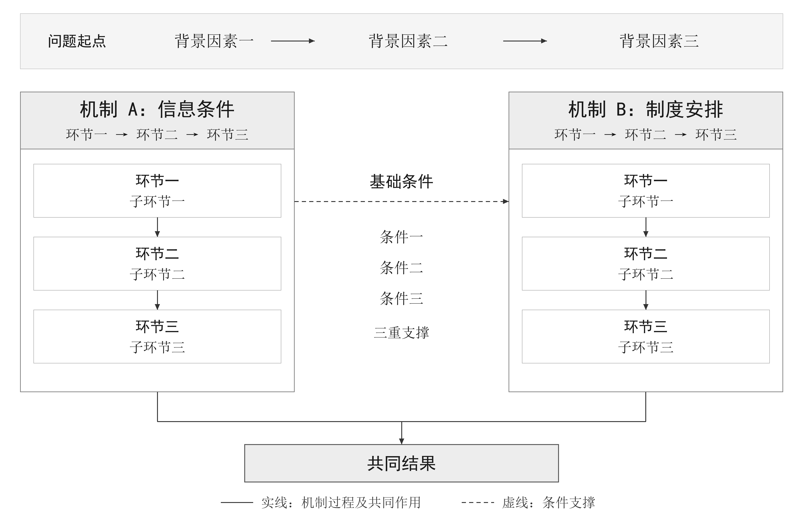
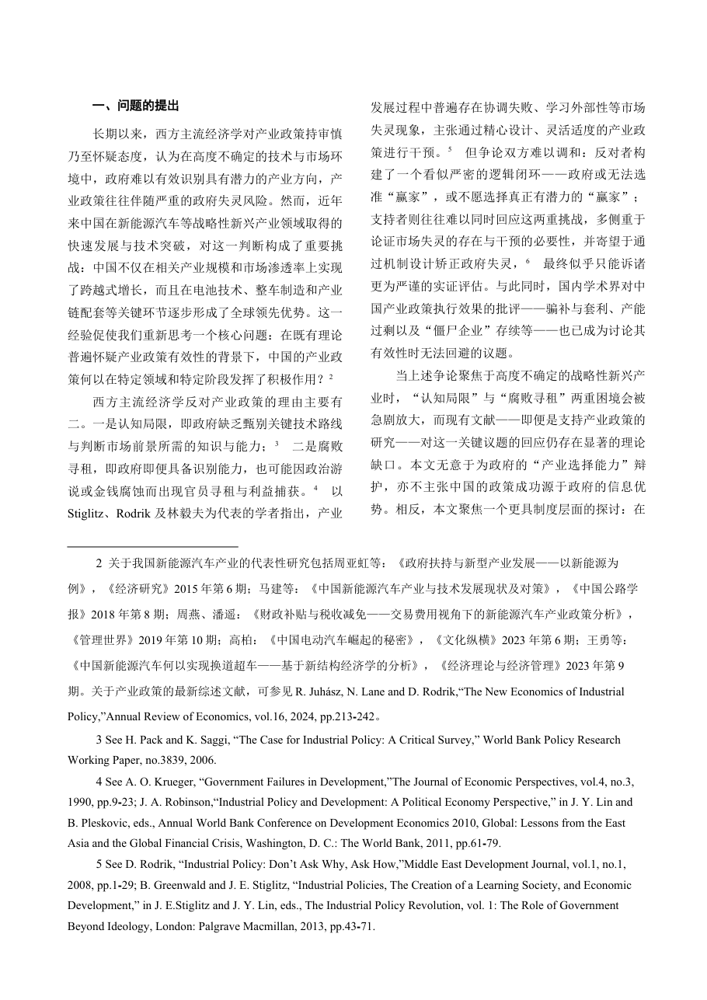

# journal-layout

把一篇中文论文排版成国内政治学与公共管理四本顶刊投稿版式的 AI Agent Skill。

支持四个刊：**《政治学研究》《中国行政管理》《公共管理学报》《管理世界》**。
同一份底稿可以派生出四个刊的版本，版式参数集中在 `scripts/journal_layout.py` 的 `SPECS` 里，
加一个刊 = 加一个 dict。

## 它解决什么问题

给期刊投稿时，同一篇论文往往要按不同刊的版式各排一版：页面尺寸、页边距、标题层级、
正文行距、页下注编号（①②③、逐页重编）、三线表、图件与题注位置、甚至单栏双栏都不一样。
手工在 Word 里调，改一处要重敲一遍检查，还容易改坏正文。

这个 skill 把这件事变成：

```
Markdown 原稿  →  语义化底稿  →  套用期刊版式  →  结构断言校验
```

而且**区分两种目标**，因为两者的参数完全不同：

| | `--mode submission` 投稿版式 | `--mode published` 刊出版式 |
|---|---|---|
| 像什么 | 交编辑部的稿子：字大、单栏、行距松 | 已经印出来的那一页：小字密排、可能双栏 |
| 参数来源 | 投稿须知 + 已交付成品 | 已刊例文 PDF 实测 |
| 正文典型值 | 宋体 12pt / 行距 17–19pt | 9.4–11.7pt / 行距 15–19pt |

三个关键设计：

1. **参数与算法分离**：版式数值全在 `SPECS` / `PUBLISHED_SPECS`，脚本只认字段。
   没依据的项留 `None`，脚本跳过并提示"未确认"——不猜。
2. **只改版式不改文字**：跑完用 `--ref` 比对底稿文本，证明正文一字未动。
3. **数值断言代替逐页看图**：直接读 docx 的 XML 断言字体/字号/行距/边距/页下注格式/
   图宽/题注位置。三十页的稿子一秒出结论，不用渲染。

## 安装

把整个目录放进 skill 目录：

```bash
# Claude Code / 兼容 skills 的 Agent
cp -r journal-layout ~/.claude/skills/

# 或者 DSH
cp -r journal-layout ~/.dsh/skills/
```

依赖：

```bash
pip install python-docx lxml Pillow          # 核心
pip install pymupdf                          # 可选：抽页预览、测量例文 PDF
```

LibreOffice 仅在 `render_preview.py`（抽页预览）时需要。

## 快速开始

```bash
S=./scripts

# 1) 看内置四刊参数（--mode published 可看刊出版式参数）
python $S/journal_layout.py --list

# 2) Markdown → 语义化底稿（自动生成真正的 Word 页下注与三线表）
python $S/md2docx.py --md 论文.md --out 底稿.docx \
    --figure-dir 图件 --figure-width-cm 14.8

# 3) 套用《政治学研究》版式（--mode published 则是仿刊出样张）
python $S/journal_layout.py --journal politics --mode submission \
    --src 底稿.docx --out 论文_政治学研究.docx

# 4) 结构校验（主验收手段）
python $S/verify_layout.py --docx 论文_政治学研究.docx --journal politics \
    --mode submission --ref 底稿.docx --strict

# 5) 需要看图时，只抽可疑页
python $S/render_preview.py --docx 论文_政治学研究.docx --pages 1 7 12
```

已有 Word 稿的话，跳过第 2 步，直接从第 3 步开始。

图件子系统画出来的机制图（`examples/figure1_demo.py`，Pillow 与 SVG 同源输出，600 dpi）：



## 目录

```
journal-layout/
├── SKILL.md                     Agent 读取的入口：何时用、七步流程、验收门
├── scripts/
│   ├── journal_layout.py        投稿版式参数表（SPECS）+ 套版算法，--mode 切换
│   ├── published_specs.py       刊出版式参数表（PUBLISHED_SPECS，例文实测）
│   ├── md2docx.py               Markdown → 语义化 docx 底稿
│   ├── footnotes.py             页下注注入/样式（直接写 OOXML）
│   ├── verify_layout.py         结构断言校验
│   ├── render_preview.py        抽页预览（可选）
│   ├── snapshot.py              留档 + 部件级差异断言
│   ├── figlib.py                学术示意图绘图原语（Pillow + SVG 双输出）
│   └── embed_figure.py          替换 docx 内嵌图
├── references/
│   ├── journal-specs.md         四刊逐项参数：例文实测 / 投稿须知 / 已落地脚本 三方核对
│   ├── workflow.md              工程纪律：目录约定、底稿策略、验收分层、交付清单
│   ├── figure-specs.md          图件规范：通栏宽、灰度、字号、论证核对表
│   └── pitfalls.md              踩坑记录：LibreOffice、中文路径、OOXML 细节
└── examples/
    ├── figure1_demo.py          机制图示例（产出 examples/out/）
    ├── endnote_demo.py          文末注释通道示例
    └── zhou-li-an/              端到端示例：一篇已刊论文 × 四刊 × 两模式
```

## 示例：一篇已发表论文的四刊排版

[`examples/zhou-li-an/`](examples/zhou-li-an/) 是一次完整的端到端演练：把周黎安的
《有组织的发现：中国特色的产业政策执行机制》（《中国社会科学》2026 年第 8 期）
从 PDF 提取成 Markdown 底稿，再用本 skill + 四刊参数表排出**四刊 × 两种模式**共 8 份 docx，
全部通过 `verify_layout.py --strict` 的结构断言（版式数值 + 原文一字未改）。

《中国行政管理》刊出版式的双栏正文页：



四刊风格差异肉眼可见：单栏/双栏、正文字号、摘要标签（`内容提要:` / `［摘　要］`）、
注释制式（页下注 vs 文末「注释」）。逐刊参数与实测依据见
[`references/journal-specs.md`](references/journal-specs.md)。

> **免责声明**：示例论文的著作权归作者与《中国社会科学》编辑部所有。本仓库收录的
> 排版产物仅为**非商业、教育/技术演示**用途，不构成对原文的再授权；不得用于商业用途、
> 不得转载或再发布原文内容；排版参数来自各刊已刊例文实测，与该刊无关。如权利人要求，
> 将立即删除相关内容。引用原文请以正式发表版本为准。

## 关于参数的可信度

四刊参数是三方核对出来的，`references/journal-specs.md` 里逐项标了出处
（〔实测〕179 处 / 〔须知〕28 / 〔脚本〕24 / 〔未确认〕19）：

- **例文实测**：把已刊 PDF 测量得到的真实数值，优先级最高 → 进 `PUBLISHED_SPECS`
- **投稿须知**：官方文件的规定，常与真实刊出版式有出入
- **已落地脚本**：原项目里真正跑过并交付的数值 → 进 `SPECS`

三者冲突的地方如实并列，不取平均、不替用户决定。文档里明确标注了哪些项是
**未确认**（例如《政治学研究》例文全文无图，所以该刊"图题在上还是在下"没有依据；
《公共管理学报》正文字号三个实测值不自洽，名义字号未确认）。
`verify_layout.py` 会在结论里列出"未核对项"，避免把"没核对"读成"已符合"。

几个已知的、需要人工拍板的点（详见 `journal-specs.md` 各刊末的"最没把握"注释）：

- 《政治学研究》页高 285 mm 而非 A4 的 297 mm；页边距实测的是墨迹顶，Word 的
  `top_margin` 比墨迹顶高约 7 pt，逐点对齐时要减。
- 《公共管理学报》正文 9.44 / 10.18 / 10.56 pt 三值不自洽（疑 TrueType 子集横向拉伸），
  建议按"221.1 pt 栏宽排 21–22 字"验算后人工定 10–10.5 pt。
- **注释制式按刊定**：《管理世界》的投稿指南与已刊例文都要求文末「注释」节
  （连续编号 ①②③），其余三刊是页下注。工具用 `--notes-mode footnote|endnote`
  在底稿阶段定型，`journal_layout.py` 会把注释节摆到参考文献之前并按刊设字号。
- 《管理世界》纸刊是否双栏未确认（例文 PDF 明确单栏）。

## 出处与免责

**工具来源**：本 skill 从一个真实的投稿排版项目里提炼出来——同一篇论文要按四刊各排一版。
原项目的脚本是一次性的、硬编码的；这里把其中的判断、纪律和踩过的坑抽成了可复用工具，
并把四刊参数重新做了"例文实测 / 投稿须知 / 已交付成品"三方核对。

**示例来源**：`examples/zhou-li-an/` 的演示论文为周黎安《有组织的发现：中国特色的产业政策
执行机制》（《中国社会科学》2026 年第 8 期），由作者提供的 PDF 提取排版。

**免责声明**：

- 演示论文的著作权归作者周黎安与《中国社会科学》编辑部所有；
- 本仓库收录的排版产物（docx、预览图、Markdown 底稿）仅为**非商业、教育/技术演示**用途，
  不构成对原文的再授权；
- **不得用于商业用途**，不得转载或再发布原文内容；
- 版式参数来自各刊已刊例文实测，与《中国社会科学》无关，也不代表任何期刊的官方格式；
- 如权利人提出要求，将立即删除相关内容；
- 引用原文请以《中国社会科学》2026 年第 8 期正式发表版本为准。

## 许可

MIT（仅适用于代码与文档；示例论文的著作权不在此列）
